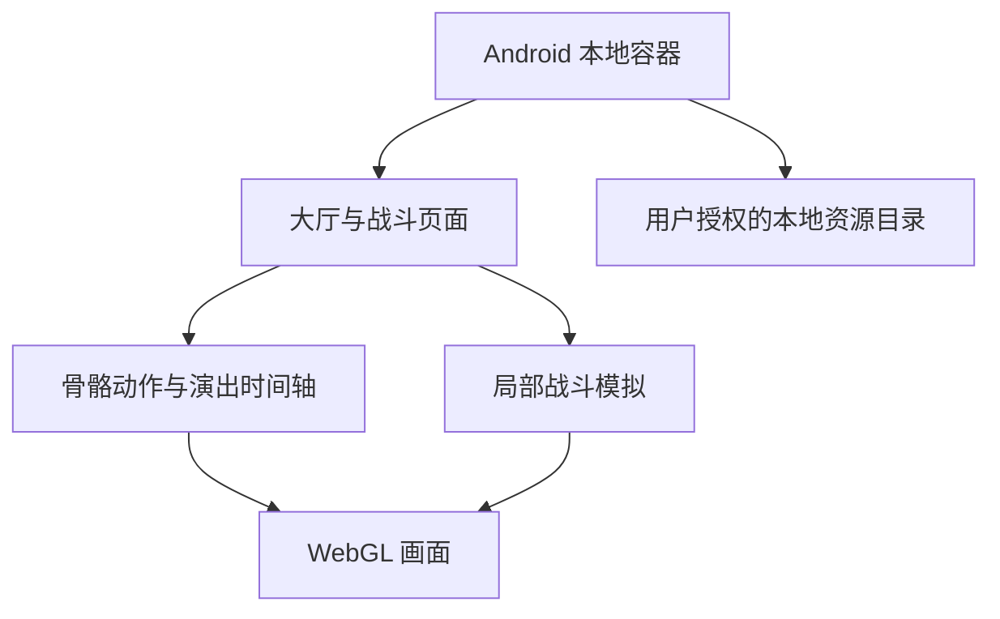

# 项目说明

整理日期：2026-10-14。研究基线：BATS 0.8.0-preview，原开发记录日期为 2026-10-03。

## 为什么做这个项目

通过实际编写一个小型 Android 原型，理解游戏画面如何从本地资源变成角色、动作、技能演出和战斗过程。最初制作离线大厅，之后扩展到角色动作预览和一个局部战斗样片。

## 实现结构

Android 容器使用 C# 和 WebView，负责目录选择、持久化目录授权以及本地请求路由。网页层组织大厅、模型预览、关卡浏览与战斗页面。WebGL 层绘制模型和场景，动画模块计算骨骼姿态与动作衔接；战斗模拟模块单独维护单位、波次、技能卡、费用和临时战斗规则。

## 已有成果及证据边界

| 部分 | 原私人环境的记录 | 公开快照的状态 |
| --- | --- | --- |
| 大厅 | 普通立绘、动态记忆大厅、声音与字幕 | 保留播放器代码，素材与运行库另行准备 |
| 模型与动作 | 232 套模型、878 段基础动作、231 套跟随记录 | 保留采样和渲染代码，不公开原模型或动作数据 |
| 战斗 | 普通 1-1 第一场样片、四前排与两支援、费用与技能轮转 | 保留执行器，源关卡数据不在仓库中 |
| 技能演出 | 六位角色的动作、镜头、语音接入记录 | 保留播放器，演出数据与配音不在仓库中 |
| 验证 | 原记录包含浏览器检查、MuMu x86_64 安装和运行证据 | 本次只检查公开文件、JavaScript 语法和无素材配置测试 |

这些数量来自历史开发记录，不是本次重新执行全量验证的结果。公开仓库不附原始截图、日志或录像，避免夹带游戏画面和环境信息。

## 尚未完成

1. 技能特效仍缺 Shader、溶解、拖尾、部分粒子及后处理。
2. HP、攻击、防御和治疗力仍包含本地演示公式；伤害、命中、暴击、装甲和掩体规则未完整恢复。
3. 减速比例等部分参数为本地展示选择，不能标为已核实的原作规则。
4. 部分骨骼绑定、演出混合、技能范围和支援行为仍需逐项验证。
5. 当前只覆盖一个局部遭遇，不能称为完整关卡或完整游戏。
6. 尚无 ARM64 原生真机全面验证。

## 与其他研究的关系

同一时期还做过原 Android 客户端启动链、协议和本地服务器可行性分析。它是另一条研究线；其阶段报告未证明完整客户端与本地兼容服务器闭环成功。这个 BATS 仓库是独立原型，不能用它来宣称原客户端已成功离线运行。

## 后续方向

先为公开仓库增加原创的几何模型、合成动作和小型测试关卡，让他人无需商业游戏素材也能验证渲染与模拟。再逐项改进动作衔接、镜头、特效和规则，并分别记录可观察现象、本地假设与验收结果。
